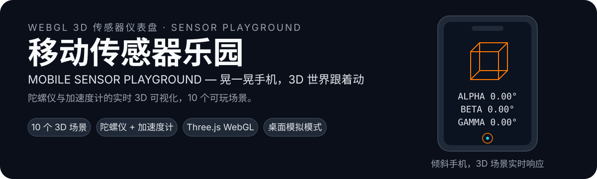
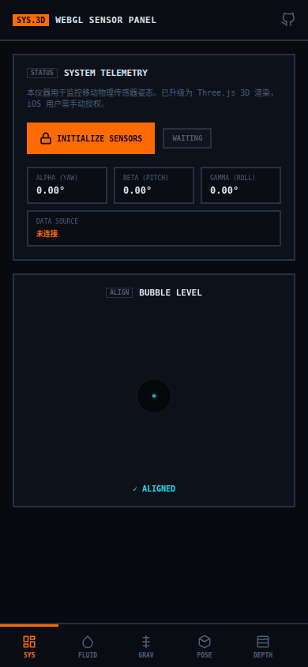
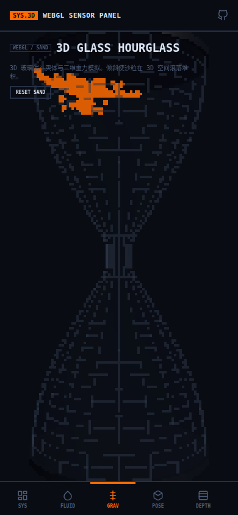

<p align="right"><a href="README.md">中文</a></p>

<p align="center">
  
</p>

<p align="center">
  <a href="https://xiaosang.cc/mobile-sensor-playground/">▶ Live Demo</a>
  ·
  <a href="https://holynova.github.io/mobile-sensor-playground/">GitHub Pages</a>
  ·
  <a href="https://github.com/holynova/mobile-sensor-playground">GitHub Repository</a>
</p>

Mobile Sensor Playground is an interactive WebGL 3D dashboard for monitoring and visualizing mobile orientation and motion sensors (gyroscope and accelerometer), built with Three.js. Best on a phone: tilt, rotate, and shake the device and 10 3D scenes respond live. A mouse-drag simulation mode covers desktop.

## Screenshots

<p align="center">
  
  
</p>

## Scenes

10 scenes in the bottom navigation, each a standalone Three.js module (`js/scene-*.js`):

| Nav | Scene | What it does |
|---|---|---|
| SYS | System telemetry + 3D bubble level | Live yaw (alpha), pitch (beta), roll (gamma) readouts; a flat, high-precision calibration bubble |
| FLUID | 3D fluid simulation | WebGL sphere particles colliding in a 3D gravity box; droplets can move along the Z axis |
| GRAV | 3D glass hourglass | Falling sand simulated in cylindrical coordinates; tilting makes grains roll and pile in 3D space |
| POSE | Gyro orientation box | A translucent wireframe box rotating with device orientation, driven by lighting, shadows and the orientation matrix |
| DEPTH | Camera parallax | A perspective camera stacks textures along the Z axis; tilting moves the camera for true 3D depth |
| MAZE | Marble maze | Tilt the phone to roll a steel ball, avoid black-hole traps, and reach the bright-orange goal block to clear the level |
| STARS | 3D compass starfield | Rotate the device to browse the stars; a dashed radar ring at the center shows the yaw angle (alpha) relative to magnetic north |
| SHAKE | Shake-to-sketch | Tilt to move the brush; a hard shake triggers a physics explosion of the strokes and clears the canvas |
| CARD | Holographic card | Tilt the card to change its reflection normal and watch laser highlights and refraction sweep across the surface |
| AUDIO | Theremin | With sound on, rolling left/right changes pitch and pitching forward/back changes volume, with a live oscilloscope line |

## How to Use

- **Phone**: open the demo, tap INITIALIZE SENSORS to grant sensor access (iOS shows a system permission prompt), then tilt, rotate, and shake the phone.
- **Desktop**: no sensors needed — drag with the mouse or touch to simulate tilt, and press Space to simulate a shake.
- **Note**: sensor APIs require a secure context (HTTPS or localhost); on iOS 13+ the permission must be requested inside a user gesture.

## Run Locally

Zero build — vanilla HTML / CSS / JS + Three.js (CDN import map, 0.160.0):

```bash
npm start    # http-server, http://localhost:8000
```

Or open `index.html` with any static server. Three.js loads from a CDN, so local runs need internet access.

## Tech

- Three.js 0.160.0 (ES modules + import map, no build step), vanilla HTML / CSS / JS.
- `app.js`: sensor access, iOS permission flow, desktop simulation, tab switching; `js/sensor-visualizer.js`: sensor data visualization; `js/scene-*.js`: one module per scene.
- Fonts: Silkscreen (pixel headings) + JetBrains Mono (monospaced readouts), in a tactical-dashboard style.

```
index.html          10 scene areas + bottom navigation + Three.js import map
app.js              Sensor access, iOS permission, desktop simulation, tab switching
js/sensor-visualizer.js   Sensor data visualization
js/scene-*.js       10 scenes: water / hourglass / cube / parallax / maze /
                    stars / shake / card / theremin
style.css           Tactical dashboard styling
```
