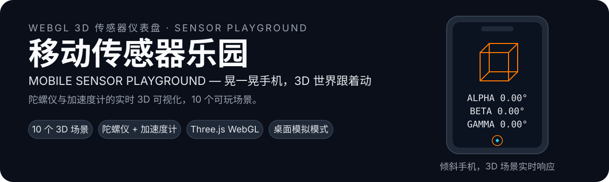
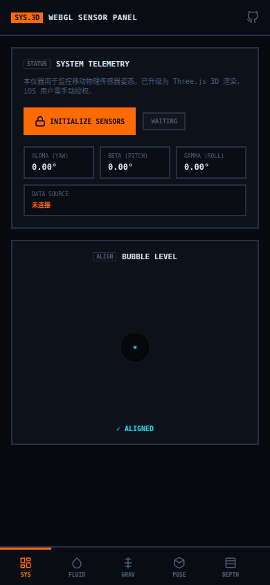
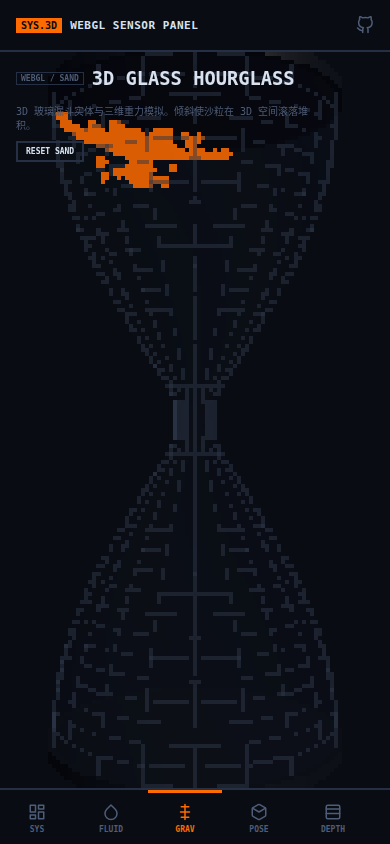

<p align="center">
  
</p>

<p align="center">
  <a href="https://xiaosang.cc/mobile-sensor-playground/">▶ 在线体验 Live Demo</a>
  ·
  <a href="https://holynova.github.io/mobile-sensor-playground/">GitHub Pages</a>
  ·
  <a href="https://github.com/holynova/mobile-sensor-playground">GitHub 仓库</a>
</p>

移动传感器乐园是一个交互式 WebGL 3D 仪表盘，实时监测并可视化手机的方向与运动传感器（陀螺仪与加速度计），用 Three.js 渲染。手机上打开效果最佳：倾斜、旋转、摇晃手机，10 个 3D 场景实时响应；桌面端也有鼠标拖动模拟模式。

Mobile Sensor Playground is an interactive WebGL 3D dashboard for monitoring and visualizing mobile orientation and motion sensors (gyroscope and accelerometer), built with Three.js. Best on a phone: tilt, rotate, and shake the device and 10 3D scenes respond live. A mouse-drag simulation mode covers desktop.

## 截图 / Screenshots

<p align="center">
  
  
</p>

## 场景 / Scenes

底部导航 10 个场景，每个场景一个独立的 Three.js 模块（`js/scene-*.js`）：

| 导航 | 场景 | 玩法 |
|---|---|---|
| SYS | 系统遥测 + 3D 水平仪 | 实时偏航（alpha）、俯仰（beta）、横滚（gamma）读数；扁平高精度校准气泡 |
| FLUID | 3D 流体模拟 | WebGL 球体粒子在 3D 重力盒内碰撞，水滴可在 Z 轴前后运动 |
| GRAV | 3D 玻璃沙漏 | 圆柱坐标物理模拟的落沙；倾斜使沙粒在 3D 空间滚落堆积 |
| POSE | 陀螺仪姿态盒 | 半透明线框盒随设备姿态旋转，受灯光阴影与姿态矩阵驱动 |
| DEPTH | 相机视差 | 透视投影相机沿 Z 轴层叠纹理，倾斜移动相机，提供真 3D 景深 |
| MAZE | 弹珠迷宫 | 倾斜手机滚动铁球，避开黑洞陷阱，滚入亮橘色终点块通关 |
| STARS | 3D 罗盘星空 | 旋转设备在星空中浏览，中央雷达虚线圈指示相对地磁偏航角（alpha） |
| SHAKE | 摇晃涂鸦 | 倾斜控制画笔移动，用力摇晃引发轨迹物理爆炸清屏 |
| CARD | 全息镭射卡 | 倾斜卡片改变反射法线，看镭射高光与折射掠过卡面 |
| AUDIO | 特雷门琴 | 开启声音后，左右翻滚改变音高，前后俯仰改变音强，示波线实时响应 |

## 使用 / How to Use

- **手机**：打开在线体验，点「INITIALIZE SENSORS」授权传感器（iOS 会弹系统授权框），然后倾斜、旋转、摇晃手机。
- **桌面**：没有传感器也能玩——鼠标 / 触摸拖动模拟倾斜，按空格键模拟摇晃。
- **注意**：传感器 API 需要安全上下文（HTTPS 或 localhost）；iOS 13+ 必须在用户手势中调用授权。

## 本地运行 / Run Locally

零构建，原生 HTML / CSS / JS + Three.js（CDN import map，0.160.0）：

```bash
npm start    # http-server，http://localhost:8000
```

或用任意静态服务器打开 `index.html`。Three.js 走 CDN，本地运行需要联网加载。

## 技术 / Tech

- Three.js 0.160.0（ES Module + import map，无构建步骤），原生 HTML / CSS / JS。
- `app.js`：传感器接入、iOS 授权流程、桌面模拟、标签切换；`js/sensor-visualizer.js`：传感器数据可视化；`js/scene-*.js`：10 个场景各一个模块。
- 字体用 Silkscreen（像素标题）+ JetBrains Mono（等宽读数），战术仪表盘风格。

```
index.html          10 个场景区 + 底部导航 + Three.js import map
app.js              传感器接入、iOS 授权、桌面模拟、标签切换
js/sensor-visualizer.js   传感器数据可视化
js/scene-*.js       10 个场景：water / hourglass / cube / parallax / maze /
                    stars / shake / card / theremin
style.css           战术仪表盘样式
```

## English

**Mobile Sensor Playground** turns your phone's gyroscope and accelerometer into 10 playable WebGL 3D scenes, rendered with Three.js 0.160.0 (ES modules, no build step).

- **Scenes**: system telemetry + 3D bubble level (yaw/pitch/roll readouts), fluid simulator, glass hourglass, gyro orientation box, camera parallax, marble maze, compass starfield, shake-to-sketch, holographic card, and a theremin (roll changes pitch, pitch changes volume, with a live oscilloscope).
- **Use it**: open the demo on a phone, tap INITIALIZE SENSORS (iOS shows a system permission prompt), then tilt, rotate, and shake. On desktop, drag with the mouse to simulate tilt and press Space to simulate a shake. Sensor APIs need a secure context (HTTPS or localhost).
- **Run it**: `npm start` (static server on `http://localhost:8000`). Three.js loads from CDN, so local runs need internet.
- **Tech**: vanilla HTML/CSS/JS + Three.js; `app.js` handles sensors, iOS permission flow, desktop simulation, and tab switching; each scene is one module under `js/`.

## 许可 / License

MIT，见 `package.json`（仓库暂无 LICENSE 文件）。
